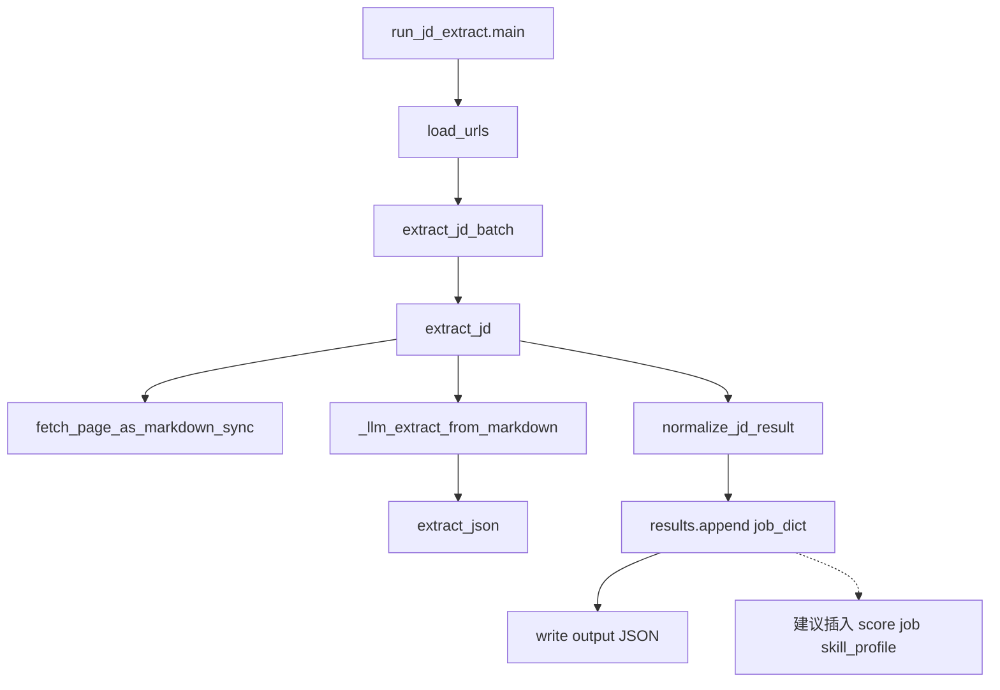

# JD 提取项目数据流梳理

## 结论摘要

- **入口**：[`scripts/run_jd_extract.py`](scripts/run_jd_extract.py)
- **Job 形态**：普通 `dict`（**没有** `Job` / `JobSchema` 类，也没有 `model_dump()`）
- **单条生成**：[`extract_jd()`](scraper_framework/job_agent/extract.py) → `normalize_jd_result()`
- **批量**：[`extract_jd_batch()`](scraper_framework/job_agent/extract.py) 循环 `append`
- **最终返回/落盘**：`run_jd_extract.main()` 写 `output/jd_extract_*.json`
- **模块2 建议插入点**：[`extract_jd_batch`](scraper_framework/job_agent/extract.py) 第 **186–187** 行附近（`extract_jd` 返回后、`results.append` 前）

包注释已写明流水线：`extract → decide → generate`（见 [`job_agent/__init__.py`](scraper_framework/job_agent/__init__.py)），但 **decide / score 尚未实现**。

---

## 完整调用链

```
scripts/run_jd_extract.py :: main()
  ↓ load_urls(data/jd_urls.txt)
  ↓ Chromium() → tab
  ↓ extract_jd_batch(tab, urls)
       ↓ for url in urls:
            ↓ extract_jd(tab, url)
                 ↓ fetch_page_as_markdown_sync(tab, url)   # page_fetcher
                 ↓ _llm_extract_from_markdown(...)         # ChatAgent + extract_json
                 ↓ result = {source_url, **empty_jd_fields()} + LLM 字段合并
                 ↓ return normalize_jd_result(result)      # schema.py
            ↓ results.append(item)
  ↓ json.dumps(results) → output/jd_extract_*.json
```



---

## 1. 项目入口

**文件路径**：[`scripts/run_jd_extract.py`](scripts/run_jd_extract.py)  
**函数名**：`main()`（约 L24–58）  
**输入**：`data/jd_urls.txt`（每行一个 URL）  
**输出**：`output/jd_extract_{timestamp}.json`（`List[dict]`）  
**调用链**：

```
run_jd_extract.py
 ↓ main()
 ↓ load_urls()
 ↓ extract_jd_batch(tab, urls)
 ↓ 写 JSON
```

---

## 2. JD 提取最终返回结果的位置

有两层“最终结果”：

| 层级 | 文件 | 函数 | 返回值 |
|------|------|------|--------|
| 库 API 最终 | [`job_agent/extract.py`](scraper_framework/job_agent/extract.py) | `extract_jd_batch` L198 | `List[Dict]` |
| 单条最终 | 同上 | `extract_jd` L167 | `Dict`（已 normalize） |
| 脚本落盘 | [`scripts/run_jd_extract.py`](scripts/run_jd_extract.py) | `main` L46–57 | 磁盘 JSON |

对调用方而言，**库层面最终返回**是 `extract_jd_batch` 的 `return results`；对人工核对而言，**脚本最终产出**是 `out_path.write_text(json.dumps(results, ...))`。

---

## 3. Job 对象（dict）在何处生成

**没有 Pydantic Job 类。** Schema 是字段字典 + 规整函数：

| 步骤 | 文件 | 函数 | 作用 |
|------|------|------|------|
| 空模板 | [`schema.py`](scraper_framework/job_agent/schema.py) | `empty_jd_fields()` L134 | 按 `JD_OUTPUT_FIELDS` 生成空 dict |
| LLM 原始 JSON | [`extract.py`](scraper_framework/job_agent/extract.py) | `_llm_extract_from_markdown` L66–117 | `ChatAgent.step` → `extract_json` → `dict` |
| 组装 Job | [`extract.py`](scraper_framework/job_agent/extract.py) | `extract_jd` L153–167 | `{"source_url": url, **empty_jd_fields()}` + 合并 LLM 字段 + `data_source_*` |
| 类型规整 | [`schema.py`](scraper_framework/job_agent/schema.py) | `normalize_jd_result` L142 | list/str 兜底，`job_level` → unknown |

关键代码（约 L153–167）：

```python
result: Dict[str, Any] = {"source_url": url, **empty_jd_fields()}
# ... 合并 LLM 字段 ...
return normalize_jd_result(result)
```

对应你示例里的 `JobSchema.model_dump()`，在本项目中实际是：

```
empty_jd_fields() + LLM 合并 + normalize_jd_result(result)
```

---

## 4. 批量处理多个 JD 的逻辑

**文件路径**：[`scraper_framework/job_agent/extract.py`](scraper_framework/job_agent/extract.py)  
**函数名**：`extract_jd_batch(tab, urls, model=None, max_retries=3)`（L170–198）  
**输入**：浏览器 `tab`、`urls: List[str]`  
**输出**：`List[Dict[str, Any]]`  
**行为**：顺序循环；跳过空行/`#`；单条异常不中断，失败项仍 `append` 带 `error` 的空字段 dict。

URL 加载：同文件 `load_urls(path)`（L201–210），由入口脚本调用。

---

## 5. 各节点速查卡

### A. 入口

- **文件**：`scripts/run_jd_extract.py`
- **函数**：`main`
- **输入**：`data/jd_urls.txt`
- **输出**：`output/jd_extract_*.json`
- **调用链**：`main` → `load_urls` → `extract_jd_batch` → 写文件

### B. 批量

- **文件**：`scraper_framework/job_agent/extract.py`
- **函数**：`extract_jd_batch`
- **输入**：`tab`, `urls`, `model?`, `max_retries`
- **输出**：`List[job_dict]`
- **调用链**：`for url` → `extract_jd` → `results.append`

### C. 单条抽取（Job 生成）

- **文件**：`scraper_framework/job_agent/extract.py`
- **函数**：`extract_jd`
- **输入**：`tab`, `url`, `model?`, `max_retries`
- **输出**：规范化后的 `job_dict`
- **调用链**：`fetch_page_as_markdown_sync` → `_llm_extract_from_markdown` → 合并字段 → `normalize_jd_result`

### D. LLM 抽取

- **文件**：`scraper_framework/job_agent/extract.py`
- **函数**：`_llm_extract_from_markdown`
- **输入**：`markdown`, `url`, `model_name`, `max_retries`
- **输出**：`Optional[Dict]`（原始 LLM JSON）或 `None`
- **调用链**：`get_model` → `ChatAgent.step` → `extract_json`

### E. Schema / 规整

- **文件**：`scraper_framework/job_agent/schema.py`
- **函数**：`empty_jd_fields` / `normalize_jd_result`
- **输入**：无 / 原始 `dict`
- **输出**：Decide 友好的字段 dict（含 `required_skills` 等数组字段）

---

## 模块2 插入建议（默认选型）

**如果接入模块2，建议在 `scraper_framework/job_agent/extract.py`、`extract_jd_batch` 函数、约第 186–187 行附近插入评分逻辑。**

具体位置：

```python
item = extract_jd(tab, url, model=model, max_retries=max_retries)
# ← 这里：item 已是完整规范化 job dict
# 建议：若 item.get("extraction_status") == "page_invalid": 跳过评分
#       否则 item["match_score"] = score(item, skill_profile)
results.append(item)
```

**理由**：
1. Job dict 已完整（含 `required_skills` / `preferred_skills` / `tech_stack` 等 Decide 字段）
2. 批量循环天然适合逐条打分并写回同一结构
3. 所有走 `extract_jd_batch` 的调用方（含入口脚本）自动带上分数
4. 保持 `extract_jd` 纯抽取，便于单测与人工核对模块1

**备选（更解耦）**：若希望严格分层 `extract → decide`，可在 [`run_jd_extract.py`](scripts/run_jd_extract.py) L46 `results = extract_jd_batch(...)` 之后统一 `for job in results: score(...)`；本计划默认推荐 batch 内插入，因为 skill_profile 可一次传入 batch，且库 API 更完整。

**注意**：schema 已声明 `extraction_status=page_invalid` 的 JD 应丢弃、不参与后续决策——打分前应先过滤。
