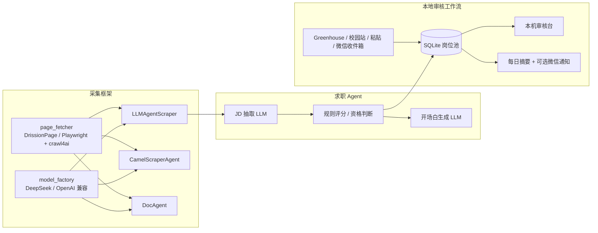
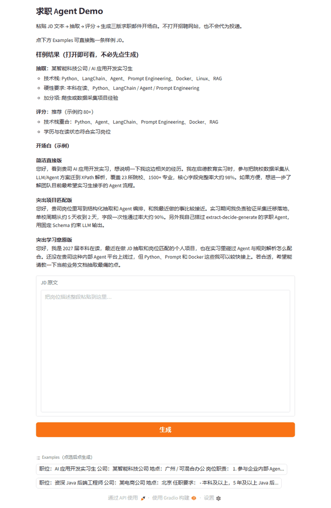

# Agentic Web Scraper

基于 LLM Agent 的网页结构化采集框架，以及在它之上落地的一个**求职 Agent**：从 JD 抽取、匹配评分、开场白生成，到本地批量审核、每日岗位发现和微信摘要通知。

项目分两层：

- **采集框架**（`scraper_framework/agents`、`tools`、`spider` 等）：基于 CAMEL-AI + DrissionPage/Playwright + crawl4ai，提供单页抽取、多 URL 编排、Agent 自主翻页探索三种模式，以及字段映射、PDF 视觉解析、多线程爬虫基类。
- **求职 Agent**（`scraper_framework/job_agent`、`job_workflow`）：把采集能力用在真实求职场景，重点处理"LLM 输出不可完全信任"和"任何对外联系都必须由人确认"这两个约束。

## 亮点

- **三种 Agent 采集模式**：单次 LLM 抽取；解析→子 Agent 逐页提取→合并 Agent 汇总；以及给 LLM 一个 `fetch_document` 工具、由它自主决定下一跳的 DocAgent（外层负责步数上限、URL 去重和停滞检测）。
- **LLM 与规则分工**：JD 抽取和开场白生成用 LLM；岗位评分、资格判断、偏好校准全部是可单测的确定性规则，分数不依赖模型心情。模型可通过环境变量切换做 A/B 对比。
- **离线优先的审核工作流**：SQLite 岗位池记录每次 JD 修订、材料、审批和跟进；审批绑定当时的 JD 与材料哈希，任一变化即失效，默认 24 小时过期。系统**没有任何自动投递或发消息的通道**，只生成待人工复制的材料。
- **可靠的增量来源**：Greenhouse 官方 API 只有在整批读取和导入都成功时才把缺席岗位标记为"来源缺失"，失败或不完整响应不会误判下架；截止日期过期后自动暂停审批。
- **每日摘要与微信通知**：计划任务每天跑一次、全程不调用模型；摘要无变化不重复推送，通知只有在 CLI 明确返回成功后才推进状态，超时视为结果未知、不在本次运行内重试。
- **微信收件箱插件**：Hermes 网关插件把白名单私聊里的 JD 文本写入本地 JSONL，再由每日任务增量导入，招聘 App 里复制的多条 JD 可一次粘贴、自动拆分。
- **离线测试**：`tests/` 下的用例使用本地夹具、临时 SQLite 和 mock，不消耗模型额度、不登录招聘账号。

## 架构



## 求职 Agent Demo

粘贴 JD → 抽取 → 评分 → 三版求职邮件开场白。打开即可看样例，不必先当用户。



```bash
# 本地
python spaces/job_demo/app.py

# Hugging Face Spaces（需先 hf auth login；会读取 .env 里的 DEEPSEEK_API_KEY）
python spaces/job_demo/deploy.py

# ModelScope 创空间：先在魔搭网页创建 Gradio 空间，再把导出目录推进该 git 仓库
python spaces/job_demo/deploy.py --out ./space_build
```

公开链接在登录对应平台并完成上面的命令后生成：

- Hugging Face: `https://huggingface.co/spaces/<username>/job-agent-demo`
- ModelScope: 创空间页面给出的 `https://www.modelscope.cn/studios/<username>/job-agent-demo`

## 本地求职审核工作流

不调用 LLM，用仓库自带的虚构岗位即可体验：

```bash
python scripts/run_job_workflow.py --db output/job_workflow/demo.sqlite3 import-json data/job_workflow_examples.json
python scripts/run_job_workflow.py --db output/job_workflow/demo.sqlite3 serve
```

浏览器打开 `http://127.0.0.1:8765`，可以看到"优先考虑 / 需要核实 / 明确不符合"三类岗位、判断理由和待审核文案。批准后只会得到可复制的材料，发送和进度登记都由人完成。

| 文档 | 内容 |
| --- | --- |
| [docs/JOB_WORKFLOW.md](docs/JOB_WORKFLOW.md) | 审核台、CLI 子命令、审批语义、Greenhouse 来源 |
| [docs/JOB_DAILY.md](docs/JOB_DAILY.md) | 每日公开岗位发现、Windows 计划任务、微信通知与收件箱 |
| [docs/ENVIRONMENT.md](docs/ENVIRONMENT.md) | 可复现的 Windows 环境与已知依赖冲突 |

个人求职画像 `data/skill_profile.json` 不入库，没有时自动使用 `data/skill_profile.demo.json`。

## 安装

**不要直接 `pip install -r requirements.txt`。**  
新版 pip 的依赖解析器会因为 `camel-ai`（要求 `psutil<6`）和 `crawl4ai`（要求 `psutil>=6.1.1`）声明冲突而报 `ResolutionImpossible`。按下面步骤安装即可绕过；Windows 上也可以用 [docs/ENVIRONMENT.md](docs/ENVIRONMENT.md) 里的 `uv` + 锁文件方式完整复现。

### 1. 创建并激活虚拟环境

```bash
python -m venv .venv

# Windows PowerShell
.\.venv\Scripts\Activate.ps1

# macOS / Linux
# source .venv/bin/activate
```

### 2. 安装 Python 依赖（推荐方式）

```bash
python -m pip install -U pip

# 必须加 legacy-resolver：否则会因 camel-ai / crawl4ai 的 psutil 区间冲突直接失败
python -m pip install -r requirements.txt --use-deprecated=legacy-resolver
```

装完后强制钉到实测可用的组合（防止解析过程中被拉到 `mcp 2.x` 或 `psutil 7.x`）：

```bash
python -m pip install "mcp>=1.3.0,<2" "psutil>=6.1.1,<7"
```

冒烟检查：

```bash
python -c "from camel.agents import ChatAgent; from mcp.server import FastMCP; print('deps ok')"
```

### 为什么不能裸装？

| 包 | 约束 | 说明 |
|---|---|---|
| `mcp` | `>=1.3.0,<2` | **硬冲突**：`camel-ai` 仍 import `FastMCP`；装到 `mcp 2.x` 会直接 `ImportError` |
| `psutil` | `>=6.1.1,<7` | **软冲突**：`crawl4ai` 要 `>=6.1.1`，`camel-ai` 元数据写 `<6`；`6.1.x` 两边实测都能 import |
| `pydantic` | `<=2.12.0` | 与 `camel-ai` 声明范围对齐 |

`pip check` 仍可能提示：

```text
camel-ai ... requires psutil<6, ..., but you have psutil 6.1.x
```

可忽略。不要为了消警告去装 `psutil 5.x` 或 `7.x`。

### 3. 安装浏览器依赖

```bash
# Playwright（crawl4ai 会用到）
python -m playwright install chromium

# DrissionPage（首次会拉起 Chrome）
python -c "from DrissionPage import Chromium; Chromium()"
```

### 4. 配置环境变量

```bash
# Windows PowerShell
Copy-Item .env.demo .env

# macOS / Linux
# cp .env.demo .env
```

最少配置：

```env
DEEPSEEK_API_KEY=sk-xxx
CRAWL_MODEL=deepseek
```

### 5. 若已装坏，快速修复

```bash
# mcp 2.x 导致 FastMCP ImportError 时
python -m pip install "mcp>=1.3.0,<2"

# psutil 版本不对时
python -m pip install "psutil>=6.1.1,<7"
```

## 采集框架快速开始

### 1. LLM Crawl - 最简单的爬取方式

提供 URL，让 LLM 自动爬取并提取结构化数据:

```python
from DrissionPage import Chromium
from scraper_framework.agents.llm_agent import LLMAgentScraper

# 创建浏览器和 Tab
tab = Chromium().new_tab()

# 创建爬取器
scraper = LLMAgentScraper(tab, model="deepseek")

# 爬取 - 提供 URL 和要提取的字段
result = scraper.crawl(
    msg="产品页面：https://example.com/product/123",
    output_fields={
        "product_name": "产品名称",
        "price": "价格",
        "description": "产品描述",
    },
)

print(result)
# {"product_name": "...", "price": "...", "description": "..."}
```

### 2. LLM Crawl 便捷函数 - 自动合并数据

```python
from DrissionPage import Chromium
from scraper_framework.agents.llm_agent import llm_crawl

tab = Chromium().new_tab()

# 已有数据
existing_data = {"url": "https://example.com/page", "name": "已知名称"}

# LLM 爬取并合并（不覆盖已有非空值）
result = llm_crawl(
    tab=tab,
    msg="页面内容：https://example.com/page",
    existing_data=existing_data,
    output_fields={"name": "名称", "price": "价格", "category": "分类"},
    model="deepseek",
)

print(result)
# {"url": "...", "name": "已知名称", "price": "...", "category": "..."}
```

### 3. Agent Crawl - 多 URL 分发爬取

适用于需要从多个不同页面提取信息并合并的场景:

```python
from DrissionPage import Chromium
from scraper_framework.agents.camel_agent import CamelScraperAgent, CamelScraperConfig

tab = Chromium().new_tab()

config = CamelScraperConfig(model="deepseek", max_retries=3)
agent = CamelScraperAgent(tab, config)

result = agent.run(
    msg="""
    产品页面：https://example.com/product/123,
    价格页面：https://example.com/product/123/pricing,
    评价页面：https://example.com/product/123/reviews
    """,
    field_descriptions={
        "product_name": "产品名称",
        "price": "价格",
        "rating": "评分",
        "reviews": "用户评价摘要",
    },
    user_prompt="优先从产品页面提取基本信息，价格从价格页面提取",
)

print(result)
```

### 4. DocAgent - 自主翻页探索

只给起始页和任务，由 Agent 通过 `fetch_document` 工具自己决定访问哪些链接；`max_depth` 限制总步数，连续两步没有调用工具即视为停滞并结束:

```python
from DrissionPage import Chromium
from scraper_framework.agents.doc_agent import DocAgent

tab = Chromium().new_tab()
agent = DocAgent(tab, max_depth=10)

result = agent.run(
    start_url="https://example.com",
    task="找到所有 Data Science 相关硕士项目，提取申请要求",
    output_fields={
        "program_name": "项目名称",
        "entry_requirements": "申请要求",
    },
)

print(result.data)
```

### 5. LLM Mapper - 批量字段映射

从参考内容中为批量数据匹配字段值:

```python
from scraper_framework.mapper import llm_mapper

# 待补充的数据
data = [
    {"id": "1", "product_name": "iPhone 15"},
    {"id": "2", "product_name": "Samsung Galaxy S24"},
]

# 参考内容 - 映射关系
reference = {
    "type": "mapping",
    "data": {
        "iPhone 15": {"price": "$799", "brand": "Apple"},
        "Samsung Galaxy S24": {"price": "$899", "brand": "Samsung"},
    }
}

result = llm_mapper(
    data=data,
    reference=reference,
    match_field="product_name",
    target_fields=["price", "brand"],
    id_field="id",
)

print(result)
# [
#   {"id": "1", "product_name": "iPhone 15", "price": "$799", "brand": "Apple"},
#   {"id": "2", "product_name": "Samsung Galaxy S24", "price": "$899", "brand": "Samsung"},
# ]
```

### 6. PDF 视觉解析

从 PDF 文件中提取结构化数据:

```python
from scraper_framework.scrapers import pdf_crawl

existing_data = {"url": "https://example.com/doc.pdf"}

result = pdf_crawl(
    pdf_urls=["https://example.com/doc.pdf"],
    existing_data=existing_data,
    pdf_crawl_field={
        "title": "文档标题",
        "summary": "文档摘要",
        "key_findings": "关键发现",
    },
    target_keywords=["summary", "conclusion"],  # 可选：筛选 PDF 页面
)

print(result)
```

### 7. 自定义爬虫 (继承 BaseSpider)

```python
from scraper_framework.spider import BaseSpider, ScrapeResult, MixTab
from scraper_framework.agents.llm_agent import llm_crawl

class MyProductSpider(BaseSpider):
    def get_list_urls(self, tab: MixTab):
        """获取产品列表页"""
        tab.get("https://example.com/products")
        items = tab.eles("css:.product-card")
        return [
            {"url": item.ele("css:a").attr("href"), "name": item.ele("css:.name").text}
            for item in items
        ]

    def scrape_detail_page(self, tab, item_info, user_prompt=None):
        """爬取产品详情页"""
        url = item_info["url"]

        # 方式1: 使用 LLM 爬取
        result = llm_crawl(
            tab=tab,
            msg=f"产品页面：{url}",
            existing_data=item_info,
            output_fields={
                "product_name": "产品名称",
                "price": "价格",
                "description": "产品描述",
                "specs": "规格参数",
            },
        )

        return ScrapeResult(data=result)

# 使用
spider = MyProductSpider(
    school_name="my_store",
    max_workers=5,
    output_dir="output",
)
spider.run()
```

## 三种采集模式对比

| 特性 | LLM Crawl | Agent Crawl (camel_scraper) | DocAgent |
|------|-----------|---------------------------|----------|
| 入参 | URL 消息文本 | URL 消息文本 | 起始 URL + 任务描述 |
| 处理方式 | 单次 LLM 调用 | 解析→分发→提取→合并 | Tool Calling 自主导航 |
| 页面范围 | 单页面 | 调用方给定的多个页面 | Agent 自行发现的页面 |
| 终止条件 | 一次调用 | 所有 URL 处理完 | 输出 `extracted_data`、达到 `max_depth` 或停滞 |
| 复杂度 | 低 | 中 | 高 |

## 项目结构

```
scraper_framework/
├── models.py                # 通用数据模型 (ScrapeResult, ErrorInfo 等)
├── logger.py                # 日志配置
├── mapper.py                # LLM 批量字段映射
├── tools/
│   ├── model_factory.py     # LLM 模型工厂 (DeepSeek / OpenAI 兼容端点)
│   └── page_fetcher.py      # 页面抓取 (DrissionPage/Playwright + crawl4ai)
├── agents/
│   ├── llm_agent/           # 单次 LLM 抽取
│   ├── camel_agent/         # 多 URL 分发 + 子 Agent + 合并 Agent
│   └── doc_agent/           # Tool Calling 自主探索
├── spider/
│   └── base_spider.py       # BaseSpider (浏览器管理/多线程/重试/保存)
├── scrapers/
│   └── pdf_scraper.py       # PDF 视觉解析
├── prompts/                 # 默认提示词
├── job_agent/               # 求职 Agent：JD 抽取、规则评分、开场白生成
└── job_workflow/            # 本地审核工作流：SQLite、审核台、来源适配、日报

integrations/hermes_job_inbox/  # Hermes 网关插件：微信私聊 JD 文本写入本地收件箱
spaces/job_demo/                # Gradio Demo 与 Hugging Face / ModelScope 部署脚本
scripts/                        # 命令行入口（JD 抽取/评分/生成、审核工作流、每日任务）
config/job_sources.json         # 每日任务默认配置（默认关闭联网与通知）
data/                           # 示例岗位、示例画像、简历事实
docs/                           # 工作流、每日任务、环境说明
tests/                          # 离线测试
```

## 测试

测试全部离线运行：本地夹具、临时 SQLite、mock 模型与子进程，不访问招聘网站，也不会发出消息。

```bash
# 求职工作流（浏览器回归测试需要 Playwright Chromium）
python -m unittest discover -s tests -p "test_job_*.py"

# 评分与开场白生成（mock LLM）
python tests/test_decision.py
python tests/test_generate.py

# DocAgent
python tests/test_doc_agent.py
```

## 模型配置

### DeepSeek

```python
from scraper_framework.tools import get_model

model = get_model("deepseek")  # 使用 DEEPSEEK_API_KEY
```

### 本地/自定义模型

```python
model = get_model("local_qwen")  # 使用 LOCAL_API_KEY, LOCAL_BASE_URL, LOCAL_MODEL
```

### 自定义 OpenAI 兼容

```python
model = get_model(
    "my-model",
    api_key="sk-xxx",
    base_url="http://localhost:8000/v1",
    model_type="gpt-4",
)
```

## 环境变量

| 变量名 | 说明 | 必需 |
|--------|------|------|
| `DEEPSEEK_API_KEY` | DeepSeek API Key | 使用 deepseek 时必需 |
| `LOCAL_API_KEY` | 本地模型 API Key | 使用 local_qwen 时必需 |
| `LOCAL_BASE_URL` | 本地模型 API 地址 | 使用 local_qwen 时必需 |
| `LOCAL_MODEL` | 本地模型名称 | 使用 local_qwen 时必需 |
| `CRAWL_MODEL` | 默认模型 (deepseek/local_qwen) | 否 |
| `VL_BASE_URL` | 视觉模型 API 地址 | PDF 解析时必需 |
| `VL_MODEL` | 视觉模型名称 | PDF 解析时必需 |
| `VL_API_KEY` | 视觉模型 API Key（可选，默认回退 DEEPSEEK_API_KEY） | 否 |

## 使用边界

- 只读取公开页面或用户自己粘贴的文本，不登录招聘平台、不绕过反爬或访问限制。
- 不提供自动投递、自动发消息的能力；审批只代表"材料已人工核实"，发送由用户在招聘渠道完成。
- 公开可读不等于获得转载授权，请低频、个人用途使用，并遵守目标站点条款。

## License

[MIT](LICENSE)
