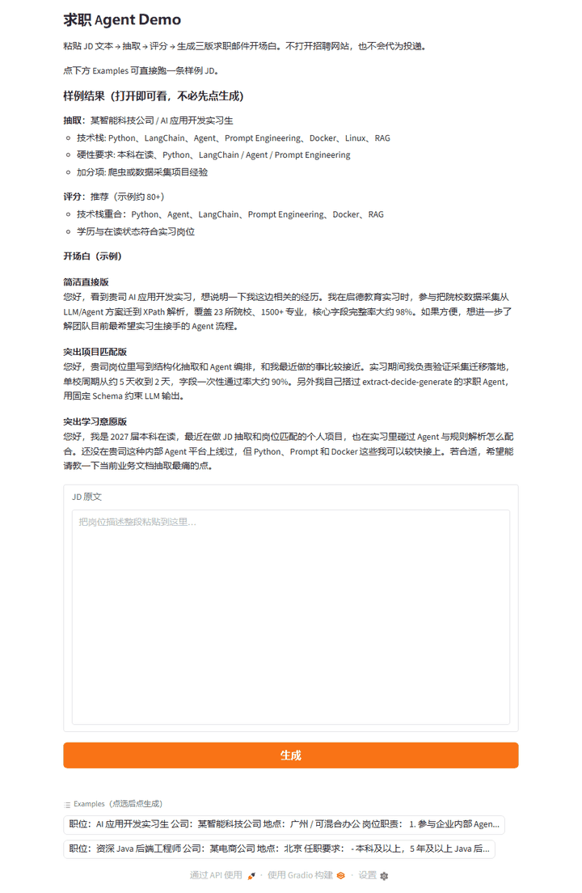

# 求职 Agent Demo

粘贴招聘 JD → 结构化抽取 → 匹配评分 → 三版求职邮件开场白。

本应用只处理粘贴文本，不打开招聘网站，也不代为发送邮件。

页面顶部有一份**静态样例结果**，打开即可看；下方 Examples 可点一条脱敏 JD 再生成。



Demo 使用作者的公开求职画像（学校、实习、项目成果），不含手机号、邮箱或证件号。

## 密钥

在 Space / 创空间 Secrets 中配置：

- `DEEPSEEK_API_KEY`
- `CRAWL_MODEL=deepseek`（可选，默认即 deepseek）

## 限流

连续生成 5 次后冷却 60 秒，冷却结束后计数清零。

## 部署

Hugging Face Spaces（需先 `hf auth login`）：

```bash
python spaces/job_demo/deploy.py
```

ModelScope 创空间：在魔搭创建 Gradio 创空间后，导出产物再推进该仓库：

```bash
python spaces/job_demo/deploy.py --out ./space_build
```

本地：

```bash
python spaces/job_demo/app.py
```
